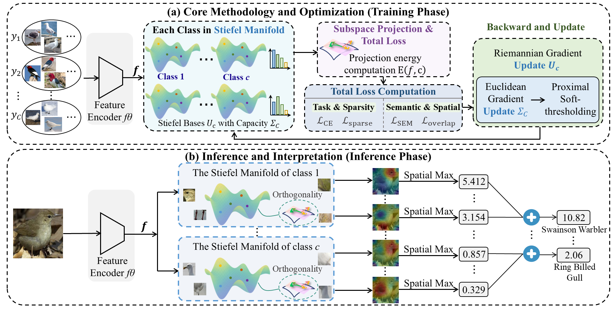

<div align="center">


[](https://link.springer.com/chapter/10.1007/978-3-032-37321-2_17)

</div>

This code is a **PyTorch** implementation of our paper "**This Looks Distinctly Like That: Grounding Interpretable Recognition in Stiefel Geometry Against Neural Collapse**".

<div align="center">

<div style="display:flex;gap:10px;">
  
</div>

</div>

**Fig. 1.** Overview of the **Adaptive Manifold Prototypes (AMP)** framework. **Training (top)**: Each class is represented by an orthonormal basis on the **Stiefel manifold** and a nonnegative capacity vector. The feature encoder, class bases and capacities are optimized using Euclidean updates, Riemannian updates and proximal soft-thresholding, respectively. **Inference (bottom)**: Capacity-weighted projection responses are aggregated into class scores, with active directions and retrieved training exemplars providing visual explanations.

## 🧑🏻‍🏫 Background

**Fine-grained image recognition** requires distinguishing visually similar categories using subtle local evidence. Prototype-based recognition makes this evidence visible by relating an input image to representative training examples. **AMP** represents each category with a learned subspace, connecting class prediction to distinct feature directions and their spatial responses.

## 😖 Current Challenges

- **Redundant prototype directions** can limit the diversity of the evidence used to explain a prediction. AMP constrains class bases to be orthonormal on the Stiefel manifold.

- A fixed collection of equally weighted prototypes does not adapt its effective complexity to each class. **Sparse, nonnegative capacities** allow the model to select its active directions.

- Interpretable predictions need evidence that can be inspected at both the feature and image levels. **Direction heatmaps and retrieved training exemplars** connect learned class representations to visible regions.

## 🌟 Primary Contributions

To address these challenges, we introduce **Adaptive Manifold Prototypes (AMP)** for interpretable fine-grained recognition. This implementation includes:

- **Class-specific orthonormal bases** $U_c \in \mathrm{St}(D,K)$ with $U_c^\top U_c=I_K$, paired with nonnegative capacities $\sigma_c \in \mathbb{R}_+^K$.

- **Capacity-weighted projection scores**, computed by spatially maximizing each direction's response and summing across directions:

  $$z_c(x)=\sum_{k=1}^{K}\max_{h,w}\;\sigma_{c,k}\left(u_{c,k}^{\top}F_{h,w}(x)\right)^2.$$

- **Joint Euclidean, Riemannian and proximal optimization**, combining cross-entropy with spatial entropy, response-overlap and sparsity objectives.

- **Visual explanations and diagnostics**, including aggregate and per-direction heatmaps, exemplar retrieval, explanation metrics and representation-collapse diagnostics.

## ⚙️ Prerequisites

- Linux/Windows
- Python >= 3.10
- PyTorch and torchvision with compatible versions
- NVIDIA GPU with CUDA for training; the entry points fall back to CPU when CUDA is unavailable

## 🧪 Implementation Details

The supplied **ResNet-50 configurations** resize inputs to $448 \times 448$ pixels, use a feature dimension of $D=128$, and allocate $K=10$ basis directions per class. `configs/cub_resnet50.yaml` configures 200 classes, while `configs/cars_resnet50.yaml` configures 196 classes. The defaults enable ImageNet-pretrained backbone weights, which torchvision downloads if they are not already cached.

The default training schedule uses **100 epochs** with batch size **32**. Euclidean SGD updates the backbone and add-on layers with learning rates of $10^{-3}$, momentum 0.9 and weight decay $10^{-4}$. Basis and capacity updates each use a learning rate of $5\times10^{-3}$. A cosine schedule is applied to the Euclidean optimizer. The spatial entropy and overlap terms each have weight $10^{-2}$, and the capacity sparsity weight is $10^{-4}$. These are the values in the supplied configurations; change them in the YAML file to select your experiment settings.

After training, the default workflow builds an **exemplar cache** containing the top five training examples for each active direction. Evaluation supports accuracy, consistency, stability, Outside-Inside Relevance Ratio (OIRR), Deletion AUC (DAUC), Pointing Game and background leakage, together with collapse diagnostics. Annotation-dependent metrics use grid or full-image fallbacks when part annotations, masks or bounding boxes are absent; provide the relevant metadata for annotation-based evaluation.

## 📦 Datasets

The repository provides sample configurations for **CUB-200-2011** and **Stanford Cars**. Dataset images and annotations are **not included**. Prepare `torchvision.datasets.ImageFolder` splits with the same class-directory names in training and test sets:

```text
datasets/cub200/train/class_001/image_001.jpg
datasets/cub200/train/class_002/image_002.jpg
datasets/cub200/test/class_001/image_003.jpg
datasets/cub200/test/class_002/image_004.jpg
```

For Stanford Cars, use the same layout under `datasets/stanford_cars/`. Adjust `data.data_root`, `data.train_dir`, `data.test_dir`, `data.train_push_dir` and `model.num_classes` in your configuration. The push split supplies images for exemplar retrieval and defaults to the training split.

The sample configurations refer to optional annotation paths. **Provide those files, or set the absent paths to `null` before training or evaluation**:

```yaml
data:
  bbox_file: null
  mask_root: null
  part_annotations_file: null
```

Bounding boxes can be provided as JSON mapping image paths to `[x1, y1, x2, y2]`, or as CSV:

```csv
path,x1,y1,x2,y2
class_001/image_001.jpg,42,35,412,377
```

Part annotations accept JSON or CSV. A JSON entry uses image coordinates and visibility flags:

```json
{
  "class_001/image_001.jpg": [
    {"name": "beak", "x": 210, "y": 140, "visible": 1}
  ]
}
```

For CSV, use `path,name,x,y,visible`. Segmentation masks are PNG files stored under `data.mask_root`, mirroring the class and image paths. Enable `data.crop_to_bbox` only when bounding-box cropping is intended.

## 🌵 Dependencies

```bash
pip install -r requirements.txt
```

The table lists the **minimum versions declared by this repository**, rather than a pinned experimental environment.

<div align="center">

| Dependencies | Versions | Dependencies | Versions | Dependencies | Versions |
|--------------|----------|--------------|----------|--------------|----------|
| torch | >= 2.2.0 | torchvision | >= 0.17.0 | numpy | >= 1.24.0 |
| Pillow | >= 10.0.0 | PyYAML | >= 6.0 | tqdm | >= 4.66.0 |
| matplotlib | >= 3.8.0 | | | | |

</div>

## 🍳 Training

After preparing the dataset and updating the configuration paths, train on CUB-200-2011:

```bash
python train.py --config configs/cub_resnet50.yaml --gpus 0
```

Or use the Stanford Cars configuration:

```bash
python train.py --config configs/cars_resnet50.yaml --gpus 0
```

To initialize a new training run from saved model weights:

```bash
python train.py \
  --config configs/cub_resnet50.yaml \
  --resume runs/resnet50/cub_resnet50/best.pt \
  --gpus 0
```

`--resume` loads model weights only; it does not restore the optimizer, scheduler or epoch counter. Add `--no-cache` to skip exemplar retrieval at the end of training.

A small synthetic CPU smoke test is provided and does not require dataset downloads or pretrained weights:

```bash
python tests/test_smoke.py
```

## 🗃️ Checkpoints

Pretrained AMP checkpoints are **not included** in this release. Training creates checkpoints under `runs/<backbone>/<experiment_name>/`. For the CUB configuration, the main outputs are:

- `runs/resnet50/cub_resnet50/config.yaml`: resolved configuration.
- `runs/resnet50/cub_resnet50/best.pt`: checkpoint selected by accuracy on the configured evaluation split.
- `runs/resnet50/cub_resnet50/epoch_005.pt`, etc.: periodic checkpoints.
- `runs/resnet50/cub_resnet50/history.json`: epoch-level metrics.
- `runs/resnet50/cub_resnet50/exemplar_cache.pt`: retrieved exemplars, unless cache building is disabled.

## 🚅 Inference

Evaluate a trained checkpoint:

```bash
python evaluate.py \
  --config runs/resnet50/cub_resnet50/config.yaml \
  --checkpoint runs/resnet50/cub_resnet50/best.pt \
  --gpus 0
```

By default, metrics are written to `evaluation_metrics.json` beside the checkpoint. Use `--output` to choose another path, `--split push` to evaluate the push split, `--skip-interpretability` to skip explanation metrics, or `--skip-collapse` to skip collapse diagnostics.

Generate an explanation for an image, replacing `path/to/image.jpg` with your input:

```bash
python explain.py \
  --config runs/resnet50/cub_resnet50/config.yaml \
  --checkpoint runs/resnet50/cub_resnet50/best.pt \
  --cache runs/resnet50/cub_resnet50/exemplar_cache.pt \
  --images path/to/image.jpg \
  --output-dir explanations \
  --gpus 0
```

Each image produces an explanation panel with class scores, an aggregate heatmap, active direction maps and retrieved exemplar crops. The configured training split must remain available because the script reads its class names; cached exemplar image paths must also remain accessible. Omit `--cache` to generate heatmaps without exemplar crops.

## 📄 License

No license file is included in this release.
